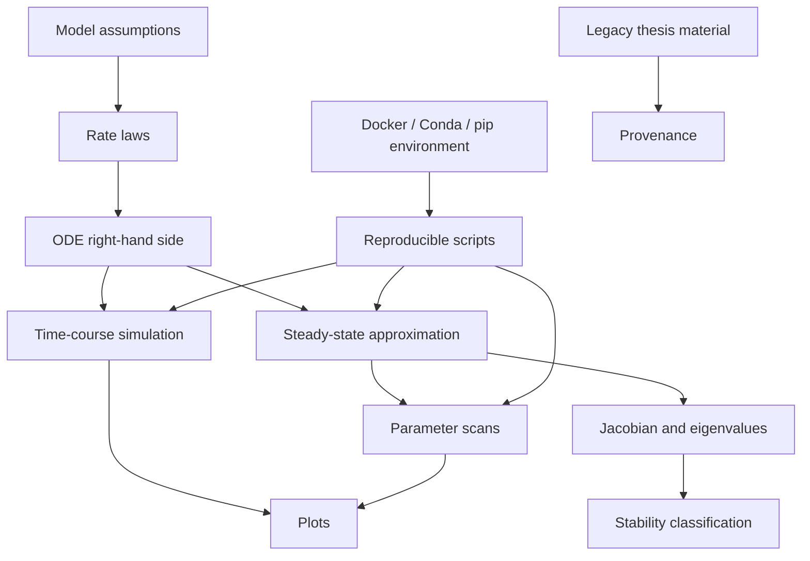

# Fatty acid metabolism bi-stability model

Research code from my PhD project at Heinrich Heine University Düsseldorf, Institute for Quantitative and Theoretical Biology:

> Chilperic Armel Foko Kuate. *Dynamic computational modeling of fatty acid de novo synthesis in the liver and qualitative analysis of fatty acid metabolism*. PhD thesis, Heinrich Heine University Düsseldorf, 2023.

This repository organizes the coarse-grained fatty-acid metabolism model used to study conditions for bi-stability in hepatic fatty-acid metabolism.

## Scientific purpose

The model represents a reduced hepatic fatty-acid metabolism system with four state variables:

- acetyl-CoA,
- malonyl-CoA,
- fatty-acid pool,
- triglycerides.

The workflow supports time-course simulation, steady-state approximation, parameter scans, Jacobian/eigenvalue diagnostics, and qualitative comparison of dynamical regimes.

## Software architecture



## Repository structure

```text
fatty-acid-metabolism-bistability/
├── src/fa_metabolism_bistability/  # reusable Python package
├── scripts/                        # runnable workflows
├── tests/                          # lightweight checks
├── docs/                           # model notes and audit notes
├── legacy/selected_original_material/ # selected original code/notebooks for provenance
├── Dockerfile
├── environment.yml
├── pyproject.toml
└── README.md
```

## Quick start

```bash
python -m venv .venv
source .venv/bin/activate
pip install -e .[dev]
python scripts/01_simulate_timecourse.py
python scripts/02_scan_acetyl_influx.py
python scripts/03_stability_diagnostics.py
```

With Docker:

```bash
docker build -t fatty-acid-bistability:latest .
docker run --rm fatty-acid-bistability:latest
```

With Conda:

```bash
conda env create -f environment.yml
conda activate fatty-acid-bistability
pip install -e .[dev]
```

## Minimal example

```python
import numpy as np
from fa_metabolism_bistability.model import default_parameters, rhs
from fa_metabolism_bistability.simulation import simulate_time_course

params = default_parameters()
y0 = np.array([1.0, 0.0, 0.0, 0.0])
result = simulate_time_course(rhs, y0, params, t_span=(0, 50), n_points=300)
print(result.y[:, -1])
```

## Reproducibility

This repository includes:

- package-style source code under `src/`,
- deterministic example scripts,
- a minimal test suite,
- Conda and pip dependency files,
- Docker execution,
- GitHub Actions smoke testing,
- selected original thesis material for provenance.

The `legacy/` folder is not the public API. It exists to document the research-code origin. The reusable implementation is in `src/fa_metabolism_bistability/`.

## Relation to thesis

This repository corresponds to the qualitative-analysis part of the PhD thesis: the coarse-grained open model of fatty-acid metabolism and its bi-stability analysis.

## License and provenance

MIT license. Check legacy files before reusing them outside this repository, because they preserve exploratory research material and may contain old comments, drafts, or dependencies.

## Maintaining this repository

See [CONTRIBUTING.md](CONTRIBUTING.md) for the directory map, output conventions, provenance and cleanup boundaries.

## Reproducible 0.2 workflow

See [reproduction instructions](docs/REPRODUCING.md), [scientific migration notes](docs/MIGRATION-0.2.md), and the [FAIR implementation record](docs/FAIR.md). Numerical reliability checks do not substitute for empirical validation.
